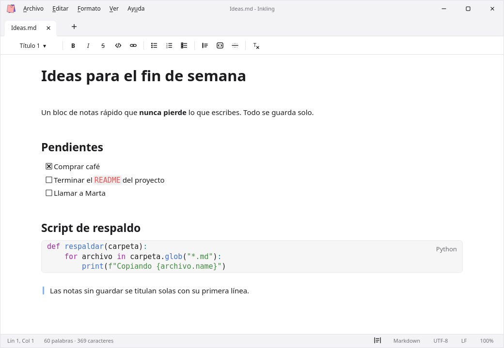

  

<h1 align="center">Inkling</h1>

  Un bloc de notas rápido, con pestañas, que nunca pierde lo que escribes.

  <a href="../../releases/latest"><b>Descargar la última versión</b></a>
  &nbsp;·&nbsp; Windows &nbsp;·&nbsp; Linux

  

## Qué es

Inkling es un bloc de notas nativo, ligero y rápido. Escribes como en cualquier editor y el formato aparece solo: `# ` crea un título, `- ` una lista, `**así**` pone negrita. Por debajo todo se guarda en Markdown estándar (`.md`), así que tus notas se abren en cualquier otro programa.

## Lo principal

- **Nunca perder nada.** Cada nota se guarda en disco al instante, aunque nunca la hayas guardado como archivo. Al cerrar y volver a abrir, todo vuelve tal cual: ventanas, pestañas, cursor y scroll.
- **Pestañas y ventanas.** Arrastra una pestaña fuera para convertirla en ventana, o sobre otra ventana para unirla. Fija pestañas, cámbiales el nombre y recupera las cerradas con Ctrl+Shift+T.
- **Markdown mientras escribes.** Títulos, listas, casillas de tareas, citas, enlaces, líneas y bloques de código con resaltado para 28 lenguajes.
- **Texto plano también.** Los `.txt` y los archivos grandes abren en modo texto, rápido y sin formato.
- **A tu gusto.** Tema claro u oscuro, texto centrado o a todo el ancho, zoom, corrector ortográfico, buscar y reemplazar, paleta de comandos e historial de versiones de cada nota.

## Instalación

Descarga el archivo de tu sistema desde [Releases](../../releases/latest). Los enlaces "Source code" que GitHub añade a cada versión no son el programa, no los necesitas.

| Sistema | Archivo |
|---|---|
| Windows 10 u 11 | El instalador `Inkling-…-Windows-Setup.exe`, o el `…-Windows-portable.zip` si prefieres no instalar nada |
| Linux (x86-64) | El `Inkling-…-Linux-x86_64.AppImage`: dale permiso de ejecución (`chmod +x`) y ábrelo |

En Windows puede aparecer un aviso de SmartScreen porque el instalador no está firmado con un certificado de pago. Elige *Más información → Ejecutar de todas formas*.

En la versión portable de Windows, crea un archivo vacío llamado `portable` junto a `inkling.exe` y tus notas se guardarán en esa misma carpeta.

macOS no tiene versión por ahora.

---

Este repositorio solo publica los instaladores; el código fuente es privado. Si algo falla o tienes una idea, abre un [issue](../../issues).
